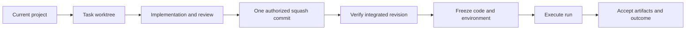

# Task Workflow

Task Workflow routes substantive development and experiment action requests
through exploration, a focused design discussion, reviewed design and plan
approvals, delegated work, evidence review, and optional frozen runs.
It combines a skill, recovery and communication hooks, and a Python workflow
program exposed through command-line and MCP tools.

## Install and enroll

Use Python 3.9 or later. The runtime uses the Python standard library. Git is
required for development worktrees and integration.

```sh
git clone https://github.com/zihaozou/task-workflow-plugin.git
cd task-workflow-plugin
```

Use a Codex CLI with `codex plugin --help` support. Put `codex` on your terminal's
PATH; a desktop app may also provide a bundled CLI. From the cloned repository,
register its one-plugin marketplace and install Task Workflow:

```sh
codex plugin marketplace add .
codex plugin add task-workflow@task-workflow-plugins
codex plugin list --marketplace task-workflow-plugins --json
```

The final command should show Task Workflow as installed and enabled. These
commands were checked with an isolated client home against this repository's
local source. They do not establish desktop rendering or hook trust. Restart
the desktop app, open its Plugins Directory, and select the Task Workflow source
if the installed plugin is not yet visible. The repository marketplace lives at
`.agents/plugins/marketplace.json`. This follows the [official local marketplace
guidance](https://developers.openai.com/plugins/build/plugins#add-a-marketplace-from-the-cli).

The Codex package uses `.codex-plugin/plugin.json`, `.mcp.json`, `skills/`,
and `hooks/hooks.json`. The manifest explicitly declares the hook file. The
client resolves `${PLUGIN_ROOT}` in server and hook commands. `mcp.json` is a
matching portable MCP declaration for other consumers.

Native discovery was checked with Codex CLI `0.164.0-alpha.11.1`. With root
`plugin.json` present, this client returned no bundled hooks, including when its
OpenAI extension explicitly declared the hook path. The selected Codex manifest
layout discovers both bundled hooks as plugin hooks. The package therefore uses
one Codex manifest and omits root `plugin.json`.
When exporting a plugin archive, include one plugin root and omit the
repository's marketplace catalog and development files.

Review and trust the bundled hooks through the host's normal hook review flow.
In Codex, use `/hooks`. Copying files does not grant hook trust. Describe the
work from your project, or invoke `$task-workflow` explicitly. The main agent
uses conversation context to route substantive development and experiment
action requests into exploration and design. Ordinary chat, advice, read-only
status, and simple requests are handled directly. Your explicit routing
choice wins. Unclear intent or task identity requires clarification before
enrollment or mutation.

A clear substantive action request authorizes enrollment for exploration and
discussion. New tasks use process protocol 2. The main skill defines a mandatory
conversation sequence: inspect actual context; restate intent and why, findings
and impact, then ask one important question; acknowledge each answer and record
it before the dependent next question; alternate exploration, questions, and
playback. Playback separates user requirements, agent proposals, and explicitly
delegated choices. A coherent design receives independent gap review before the
user sees and approves that exact revision. The user then sees work and
verification in a linked plan and approves its exact revision before execution.
There is no fixed number of questions or alternative designs.

Questions are recorded before sending. Actual answer sources and affected
requirements and decisions are updated before dependent progression. New important
worker discoveries return to discussion. Reentry preserves unaffected facts and
evidence; changed design or plan revisions require fresh applicable approvals.
Existing legacy tasks retain their recorded state until an authorized upgrade.
Followups reuse the correct task and perform the current requested action.
Status questions and ordinary messages receive direct answers and preserve any
existing wait target. A progress question does not restart experiments or release
resources.

The program returns a fresh `dialogue_contract` with task/state identity, stage,
pending questions and digests, missing records, ordered reply fields, required
recording steps, wait and exit conditions, exact approval target, applicability,
and allowed next operations. The coordinator must follow it with the main skill.
The program validates declared state, source links, and guarded transitions. It
cannot establish the semantic truth of conversation or guarantee model obedience.

There is no setup wizard, user configuration file, execution profile, or global
task registry. Your existing instructions can supply private conventions. The
host loads those instructions; the agent resolves them into explicit workflow
arguments. The plugin does not read, parse, modify, or require `AGENTS.md`.
Its workflow context comes from the bundled skill, hooks, and program.

The MCP process starts with the following command, which normally runs through
the client rather than an interactive terminal:

```sh
python3 skills/task-workflow/scripts/mcp_server.py
```

After connection, verify tool discovery and a harmless schema call. Discover
the operation interface from the repository with:

```sh
python3 skills/task-workflow/scripts/workflow.py schema
```

## Project paths

Tasks use the current Git project. Generated state and outputs use these paths:

| Path | Purpose |
| --- | --- |
| `.task-workflow/` | Task records, state, and recovery evidence. |
| `.worktrees/<task-id>/` | The task's fixed development worktree. |
| `.experiments/<experiment-id>/runs/<run-id>/` | Frozen experiment code and run outputs. |

An explicit experiment root can come from your existing private conventions.
The agent passes that path as an operation argument. The program maintains its
own project-local `.git/info/exclude` block for generated directories. It does
not update global settings. Existing registered paths and frozen execution
references remain preserved during recovery.

Each task has one program-generated readable `record.md` with fixed sections
for intent, exploration, confirmed requirements, sourced decisions, design,
plan, execution reviews, experiments, delivery, and decision history. Worker
briefs and reports become record sections or evidence references. The reusable
phase, conversation, record, and worker structures are in
[skills/task-workflow/templates](skills/task-workflow/templates/README.md).
The agent uses the program's operation schema to enroll the task, prepare its
worktree, review changes, and record acceptance.

## Session selection and recovery

The project records an explicit selected task for each known session.
Enrollment and `bind-session` can select another task in the same chat while
preserving historical task associations. An already associated task cannot
change its session. Selecting a closed task preserves its closure. Recovery
preserves the existing selection. Use `status` to inspect the persisted task
record with the known project and task context.

## Review, integrate, and freeze

The coordinator explores and records an approved design and plan, delegates
implementation, reviews actual changes and evidence, and accepts the complete
deliverable. A task reviewer returns separate requirements and quality verdicts
for each item; an overall reviewer checks the complete result.
Each item follows `pending -> implementing -> reviewing -> complete`. Failed
review returns the item to `implementing`.



Implementation approval and integration authorization are recorded separately.
Authorized integration creates one ordinary squash commit on the selected base,
with normal Git hooks and signing. Verify that revision before freezing dependent
runs. Cleanup checks integration proof, snapshots, and remaining references.

An experiment has one research goal and can have several frozen runs. Changed
code or arguments for the same goal creates a new run. Changed goals create new
experiments. Execution evidence and artifact acceptance are required before
accepting a result. Task, experiment, and run closure remain separate operations.
Runs and commands have no default execution time limit. A timeout is optional
and applies only when the user supplies one; the plugin does not set a maximum.
Use `run-execute`
with `detached: true` for a local launch that returns immediately, or
`run-dispatch` to save an external execution intent and obtain its exact pinned
runner argument array. Dispatch records `queued`; the actual runner checks
resource admission, makes a permanent claim, and records the workload start.
Observe or reconcile its receipt after rereading the current task version.

Resources record who provided them and their observed availability. Their derived
state is `available`, `in_use`, `releasable`, `released`, or `unknown`. Record
ownership, run references, and release permission. Your
private conventions determine concrete provisioning and execution choices; the
agent passes explicit parameters. A completed run does not authorize resource
release. The public workflow does not supply a provider-specific resource policy.

The plugin does not impose size, file-count, JSON, label, or output-length caps.
It preserves snapshot contents and provenance. Commands have no default deadlines.
Timeouts are optional and have no plugin-set maximum. Resource admission follows
actual provider availability and scheduling. Host, framework, and machine capacity
remain environmental constraints.

## Verify and recover

Run checks from the repository root:

```sh
python3 -m unittest discover -s tests -v
```

Tests cover the program, frozen runner, adapters, session bindings, hooks, and
package layout. To run the optional native installation and discovery check:

```sh
CODEX_PLUGIN_TEST_CLI=/absolute/path/to/codex python3 -m unittest discover -s tests -p test_package.py -v
```

The check stages tracked package files, installs through a local marketplace in
a temporary client home, and verifies two enabled plugin hooks with untrusted
status. It grants no hook trust and leaves the active client unchanged. After an actual installation, also verify startup, tool
discovery, a harmless call, and hook trust in the target client.
Tests do not prove installation in the active client. Reconnect the MCP process
after an update because an existing process can retain old source.

SessionStart restores safe facts for an existing task in the current
project and session. Unenrolled sessions remain quiet. UserPromptSubmit restores the current dialogue contract for the exact selected
project/session task and provides routing and naming guidance for the main agent. It does not classify
requests, call a separate model or API, parse transcripts, echo prompts, read
private instructions, or enroll tasks.

After interruption, reconcile the task record with actual Git refs, worktrees,
resource ownership, execution receipts, and artifacts before retrying an action.
Preserve uncertain integration, execution, and release results for review. Keep
runtime files and environments while existing runs reference them.

## Source provenance

This independent public repository starts with clean Git history. It adapts a
prior Task Workflow implementation and includes reusable source. Private task
records, earlier repository history, private conventions, execution data,
account settings, host paths, and caches are excluded. Publication does not
install the plugin, upload it to an account, or submit it to a plugin directory.
A project license has not been selected.
