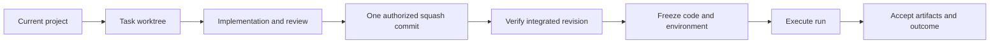

# Task Workflow

Task Workflow coordinates explicitly enrolled development tasks and frozen
experiments. It combines a skill, recovery and communication hooks, a Python
workflow program, and an optional Workflow tab in the current chat.

## Install and enroll

Use Python 3.9 or later. The runtime uses the Python standard library. Git is
required for development worktrees and integration. The optional view requires
a client with MCP Apps and thread entrypoint support.

```sh
git clone https://github.com/zihaozou/task-workflow-plugin.git
cd task-workflow-plugin
```

Use a Codex CLI with `codex plugin --help` support. Put `codex` on your terminal's
PATH; a desktop app may also provide a bundled CLI. From the cloned repository,
register its one-plugin marketplace and install Task Workflow:

```sh
codex plugin marketplace add .
codex plugin add task-workflow@task-workflow-plugins
codex plugin list --marketplace task-workflow-plugins --json
```

The final command should show Task Workflow as installed and enabled. These
commands were checked with an isolated client home against this repository's
local source. They do not establish desktop rendering or hook trust. Restart
the desktop app, open its Plugins Directory, and select the Task Workflow source
if the installed plugin is not yet visible. The repository marketplace lives at
`.agents/plugins/marketplace.json`. This follows the [official local marketplace
guidance](https://developers.openai.com/plugins/build/plugins#add-a-marketplace-from-the-cli).

The portable package uses `plugin.json`, `mcp.json`, and `skills/`. The
`.codex-plugin/plugin.json` and `.mcp.json` files provide a compatibility overlay.
The client resolves `${PLUGIN_ROOT}` in server and hook commands. When exporting
a plugin archive, include one plugin root and omit the repository's marketplace
catalog and development files.

Review and trust the bundled hooks through the host's normal hook review flow.
In Codex, use `/hooks`. Copying files does not grant hook trust. Then invoke
`$task-workflow` from your project and describe the task you want to enroll.
Ordinary chat, advice, and exploration remain outside the workflow.

There is no setup wizard, user configuration file, execution profile, or global
task registry. Your existing instructions can supply private conventions. The
host loads those instructions; the agent resolves them into explicit workflow
arguments. The plugin does not read, parse, modify, or require `AGENTS.md`.
Its workflow context comes from the bundled skill, hooks, and program.

The MCP process starts with the following command, which normally runs through
the client rather than an interactive terminal:

```sh
python3 skills/task-workflow/scripts/mcp_server.py
```

After connection, verify tool discovery and a harmless schema call. Discover
the operation interface from the repository with:

```sh
python3 skills/task-workflow/scripts/workflow.py schema
```

## Project paths

Tasks use the current Git project. Generated state and outputs use these paths:

| Path | Purpose |
| --- | --- |
| `.task-workflow/` | Task records, state, and recovery evidence. |
| `.worktrees/<task-id>/` | The task's fixed development worktree. |
| `.experiments/<experiment-id>/runs/<run-id>/` | Frozen experiment code and run outputs. |

An explicit experiment root can come from your existing private conventions.
The agent passes that path as an operation argument. The program maintains its
own project-local `.git/info/exclude` block for generated directories. It does
not update global settings. Existing registered paths and frozen execution
references remain preserved during recovery.

Each task has one readable `record.md` for design, decisions, progress, and
evidence. The agent uses the program's operation schema to enroll the task,
prepare its worktree, review changes, and record acceptance.

## Workflow tab

After enrollment, the agent opens the known task with the model-only
`workflow.status_view` tool. It provides explicit project and task context to
bind the view without asking you to configure dashboard roots. Select the
**Workflow** tab on the right side of the current chat manually.

The official `thread` entrypoint can also open the tab. That entrypoint alone
does not provide a verified current-chat identifier. A tab without a task
binding explains its unbound state; the agent can bind the known task through
the view tool. The plugin does not guess another chat's task or expose global
sidebar navigation or a native task badge.

The view shows the current workflow phase and one relevant detail from persisted
evidence. It refreshes every 10 seconds while visible. It does not query an
external execution service. The app bridge can only refresh an opaque view
reference; mutations stay with the normal workflow tools and their authorization
guards.

## Review, integrate, and freeze

The coordinator explores and records an approved design, delegates implementation,
reviews actual changes and evidence, and accepts the complete deliverable.
Each item follows `pending -> implementing -> reviewing -> complete`. Failed
review returns the item to `implementing`.



Implementation approval and integration authorization are recorded separately.
Authorized integration creates one ordinary squash commit on the selected base,
with normal Git hooks and signing. Verify that revision before freezing dependent
runs. Cleanup checks integration proof, snapshots, and remaining references.

An experiment has one research goal and can have several frozen runs. Changed
code or arguments for the same goal creates a new run. Changed goals create new
experiments. Execution evidence and artifact acceptance are required before
accepting a result. Task, experiment, and run closure remain separate operations.
Runs have no default execution time limit. An explicit positive timeout has no
maximum. Command checks retain separate bounded timeouts. Use `run-execute`
with `detached: true` for a local launch that returns immediately, or
`run-dispatch` to save an external execution intent and obtain its exact pinned
runner argument array. Dispatch records `queued`; the actual runner checks
resource admission, makes a permanent claim, and records the workload start.
Observe or reconcile its receipt after rereading the current task version.

Resources record who provided them and their observed availability. Their derived
state is `available`, `in_use`, `releasable`, `released`, or `unknown`. Record
ownership, run references, and release permission. Your
private conventions determine concrete provisioning and execution choices; the
agent passes explicit parameters. A completed run does not authorize resource
release. The public workflow does not supply a provider-specific resource policy.

## Verify and recover

Run checks from the repository root:

```sh
python3 -m unittest discover -s tests -v
```

Tests cover the program, frozen runner, adapters, read-only view, hooks, and
package layout. After an actual installation, also verify startup, tool
discovery, a harmless call, hook trust, and the Workflow tab in the target client.
Tests do not prove client rendering or installation. Reconnect the MCP process
after an update because an existing process can retain old source.

SessionStart restores safe, bounded facts for an existing task in the current
project and session. Unenrolled sessions remain quiet. UserPromptSubmit provides
fixed communication guidance without reading private instruction files.

After interruption, reconcile the task record with actual Git refs, worktrees,
resource ownership, execution receipts, and artifacts before retrying an action.
Preserve uncertain integration, execution, and release results for review. Keep
runtime files and environments while existing runs reference them.

## Source provenance

This independent public repository starts with clean Git history. It adapts a
prior Task Workflow implementation and includes reusable source. Private task
records, earlier repository history, private conventions, execution data,
account settings, host paths, and caches are excluded. Publication does not
install the plugin, upload it to an account, or submit it to a plugin directory.
A project license has not been selected.
