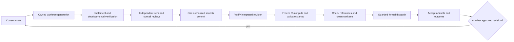

# Task Workflow

Task Workflow routes substantive development and experiment action requests
through exploration, a focused design discussion, reviewed design and plan
approvals, delegated work, evidence review, and optional frozen runs.
It combines a skill, recovery and communication hooks, and a Python workflow
program exposed through command-line and MCP tools. Codex and DeepSeek Harness
use that same program and skill through their native registrations.

## Codex installation and enrollment

Use Python 3.9 or later. The runtime uses the Python standard library. Git is
required for development worktrees and integration.

```sh
git clone https://github.com/zihaozou/task-workflow-plugin.git
cd task-workflow-plugin
```

Use a Codex CLI with `codex plugin --help` support. Put `codex` on your terminal's
PATH; a desktop app may also provide a bundled CLI. From the cloned repository,
register its one-plugin marketplace and install Task Workflow:

```sh
codex plugin marketplace add .
codex plugin add task-workflow@task-workflow-plugins
codex plugin list --marketplace task-workflow-plugins --json
```

The final command should show Task Workflow as installed and enabled. These
commands were checked with an isolated client home against this repository's
local source. They do not establish desktop rendering or hook trust. Restart
the desktop app, open its Plugins Directory, and select the Task Workflow source
if the installed plugin is not yet visible. The repository marketplace lives at
`.agents/plugins/marketplace.json`. This follows the [official local marketplace
guidance](https://developers.openai.com/plugins/build/plugins#add-a-marketplace-from-the-cli).

The Codex package uses `.codex-plugin/plugin.json`, `.mcp.json`, `skills/`,
and `hooks/hooks.json`. The manifest explicitly declares the hook file. The
native MCP declaration uses plugin-relative `cwd: "."` and
`args: ["-I", "skills/task-workflow/scripts/bootstrap.py", "--",
"skills/task-workflow/scripts/mcp_server.py"]` with `python3`. The tested
native client resolves these relative paths from the plugin root; it does not
expand `${PLUGIN_ROOT}` in MCP arguments or `cwd`. Hook commands run through a
shell and retain their quoted `${PLUGIN_ROOT}` paths. `mcp.json` is a
matching portable MCP declaration for other consumers.

Native discovery was checked with Codex CLI `0.164.0-alpha.11.1`. With root
`plugin.json` present, this client returned no bundled hooks, including when its
OpenAI extension explicitly declared the hook path. The selected Codex manifest
layout discovers both bundled hooks as plugin hooks. The package therefore uses
one Codex manifest and omits root `plugin.json`.
When exporting a plugin archive, include one plugin root and omit the
repository's marketplace catalog and development files.

Review and trust the bundled hooks through the host's normal hook review flow.
In Codex, use `/hooks`. Copying files does not grant hook trust. Describe the
work from your project, or invoke `$task-workflow` explicitly. The main agent
uses conversation context to route substantive development and experiment
action requests into exploration and design. Ordinary chat, advice, read-only
status, and simple requests are handled directly. Your explicit routing
choice wins. Unclear intent or task identity requires clarification before
enrollment or mutation.

A clear substantive action request authorizes enrollment for exploration and
discussion. New tasks use process protocol 2. The main skill defines a mandatory
conversation sequence: inspect actual context; restate intent and why, findings
and impact, then ask one important question; acknowledge each answer and record
it before the dependent next question; alternate exploration, questions, and
playback. Playback separates user requirements, agent proposals, and explicitly
delegated choices. A coherent design receives independent gap review before the
user sees and approves that exact revision. The user then sees work and
verification in a linked plan and approves its exact revision before execution.
The complete confirmed objective and acceptance remain the target through every
stage. Resolve difficulty through investigation and concrete planning; phase
dependencies without reducing scope. A confirmed requirement changes only with
explicit actual user authority recorded in `scope_changes`.
Stage replies use concise bold labels, grouped bullets or tables, and a separate
question. Empty optional groups and routine workflow narration are omitted.
Spec and Design mean the same reviewed revision in the one task record. Specs
cover complete behavior, authority, constraints, impact, failure conditions, and
acceptance. Plans assign concrete file responsibilities, interfaces, action steps,
named checks, verification commands or inspection targets, and expected outcomes.
Lifecycle phase names alone do not form an implementation plan.
There is no fixed number of questions or alternative designs.
Replies start with the current stage's content, with headings in the user's
conversation language. The English templates define meaning, not fixed display
strings. A successfully recorded question uses an available, eligible native
question card. Answers map to the exact recorded question; nonempty custom text
takes precedence, and skipped or pending responses preserve the wait. When the host
cannot provide the card, the same recorded question remains available in prose.


Questions are recorded before sending. Actual answer sources and affected
requirements and decisions are updated before dependent progression. New important
worker discoveries return to discussion. Reentry preserves unaffected facts and
evidence; changed design or plan revisions require fresh applicable approvals.
Existing legacy tasks retain their recorded state until an authorized upgrade.
Followups reuse the correct task and perform the current requested action.
Status questions and ordinary messages receive direct answers and preserve any
existing wait target. A progress question does not restart experiments or release
resources.

The program returns a fresh `dialogue_contract` with task/state identity, stage,
pending questions and digests, missing records, ordered reply fields, required
recording steps, wait and exit conditions, exact approval target, applicability,
and allowed next operations. The coordinator follows this contract with the main
skill. Its `operation_scope` limits the list to dialogue and context guidance.
Other task, review, run, resource, integration, and lifecycle operations follow
the current schema, actual guards, and existing user authorization. Closed tasks
still require authorized reopening before their work can change.
The program validates declared state, source links, and guarded transitions. It
cannot establish the semantic truth of conversation or guarantee model obedience.

Task Workflow has no setup wizard, user configuration file, execution profile,
or global task registry. Native host profiles remain host installation state. Your existing instructions can supply private conventions. The
host loads those instructions; the agent resolves them into explicit workflow
arguments. The plugin does not read, parse, modify, or require `AGENTS.md`.
Its workflow context comes from the bundled skill, hooks, and program.

The MCP process starts with the following command, which normally runs through
the client rather than an interactive terminal:

```sh
python3 -I skills/task-workflow/scripts/bootstrap.py mcp_server.py
```

After connection, verify tool discovery and a harmless schema call. Discover
the operation interface from the repository with:

```sh
python3 -I skills/task-workflow/scripts/bootstrap.py workflow.py schema
```

## DeepSeek Harness

The native `@local/task-workflow` package targets DeepSeek Harness `0.2.1-rc.3`.
It mounts the official compatible Codex Hook bridge, the shared MCP tools and
skill, and a read-only provider for current project/session context during native
request assembly. The provider refreshes context after same-turn compaction;
host-sourced context does not become human authority or force another turn.
It adds synchronous read cost before model admission.
The adapter exposes `task_workflow_delegate`, `task_workflow_wait`, and
`task_workflow_cancel` for owned Task Workflow workers. These reuse native
provider/model checks and return explicit activation handles. The coordinator
waits for actual child settlement and cleanup before final delivery. The host's
original subagent tools and the shared Python operations remain available.
Discover current tools and schemas after activation or reconnect. A remembered
tool name, child report, or background notice is not a new human instruction.

For an authorized active workflow, the adapter automatically recovers the exact
provider failure for invalid tool-argument JSON in a complete, closed set of
known workflow MCP calls. It checks the current typed failed attempt and request
identity, delegates once to native recovery, and uses
its narrow retry fallback only when native recovery declines. It rechecks the
same task and request after native backoff. Every retry is another model request
and can add input/output charges. Eligible recovery continues until valid output
or cancellation; it does not change provider/model selection or global provider
retry settings. Failed attempts remain recorded and completed task work is
preserved. Schema, tool, and workflow guard errors are not this recovery target.
Human actual-session testing remains separate from isolated recovery checks.


Build and inspect the candidate archive from the reviewed checkout. Keep its
actual filename and checksum in a durable release directory outside experiment
outputs, such as the host DSH data home under `releases/task-workflow/0.1.14/`:

```sh
npm pack --dry-run --json
npm pack --pack-destination "$archive_directory"
```

Use the filename actually returned by `npm pack`. With the app safely quit and
its profile backed up, install the reviewed archive through the supported command:

```sh
dsh plugin --profile desktop add --save-exact "$archive_path"
```

After an authorized release is pushed, prefer its immutable Git commit as the
saved installation origin:

```sh
dsh plugin --profile desktop add --save-exact \
  'git+https://github.com/zihaozou/task-workflow-plugin.git#<approved-release-commit>'
```

Verify that exact Git-installed payload against the reviewed archive. If Git
retrieval is unavailable, retain the checksum-verified archive in the durable
release directory as the installation source. Candidate artifacts retain their
test identity; a successful candidate test does not authorize publication.


The bundle adds to existing profile composition. Preserve other bundles, rows,
settings, credentials, and earlier runtime files. Package presence and saved
selection are separate from live activation after restart. Use the current
native authorized model route, including the user's selected Flash route;
Codex model names are not DeepSeek route identifiers.

Follow [the DeepSeek reference](skills/task-workflow/references/deepseek.md) for
exact package dependencies, readiness, context errors, cleanup, verification,
rollback, and long operations. It also describes native host call defaults, which
are separate from Task Workflow's unchanged workload timeout behavior. The
supported sequence is candidate installation and actual provider/delegation
checks, independent overall review, guarded integration, packaged-payload
comparison, then final installed verification. A stub test proves its observed
transport behavior, not real-provider obedience.

## Project paths

Tasks use the current Git project. Generated state and outputs use these paths:

| Path | Purpose |
| --- | --- |
| `.task-workflow/` | Task records, state, and recovery evidence. |
| `.worktrees/<task-id>/` | The task's fixed development worktree. |
| `.experiments/<experiment-id>/runs/<run-id>/` | Frozen experiment code and run outputs. |

## Project environments

Development worktrees, tests, and development checks use the existing
main/base repository environment, bound once in
`.task-workflow/environment.json` with `environment-bind`. Formal training Runs
use a separate fixed environment registered with `environment-register` as
`purpose: runtime`, with `project_distributions`, the host-resolved `cache_root`,
and an actual `install_receipt`. The receipt records successful `uv pip install`
arguments using `--python`, `--cache-dir`, and `--link-mode symlink`, zero exit
status, actual stdout/stderr logs, and their SHA-256 digests. Compare third-party
versions with main once and preserve that
provenance. Resolve compatibility in the main project's dependency declarations;
do not silently change runtime versions. Validate representative package imports
as symlinks into the shared
uv cache. Do not use copied or hardlinked packages, foreign editable installs,
overlays, or manual `.pth` workarounds. Frozen Run project code comes from its
registered source snapshot. Later main dependency changes do not invalidate an
already registered runtime. The host supplies environment and cache paths.

When a workload is paused or the user retains startup control, prepare and
verify readiness, then wait for the user's authorization to start it.

An explicit experiment root can come from your existing private conventions.
The agent passes that path as an operation argument. The program maintains its
own project-local `.git/info/exclude` block for generated directories. It does
not update global settings. Existing registered paths and frozen execution
references remain preserved during recovery.

Each task has one program-generated readable `record.md` with fixed sections
for intent, exploration, confirmed requirements, sourced decisions, design,
plan, execution reviews, experiments, delivery, and decision history. Worker
briefs and reports become record sections or evidence references. The reusable
phase, conversation, record, and worker structures are in
[skills/task-workflow/templates](skills/task-workflow/templates/README.md).
The agent uses the program's operation schema to enroll the task, prepare its
worktree, review changes, and record acceptance.

## Session selection and recovery

The project records an explicit selected task for each known session.
Enrollment and `bind-session` can select another task in the same chat while
preserving historical task associations. An already associated task cannot
change its session. Selecting a closed task preserves its closure. Recovery
preserves the existing selection. Use `status` to inspect the persisted task
record with the known project and task context.

## Review, integrate, and freeze

The coordinator explores and records an approved design and plan, delegates
implementation, reviews actual changes and evidence, and accepts the complete
deliverable. A task reviewer returns separate requirements and quality verdicts
for each item; an overall reviewer checks the complete result.
Each item follows `pending -> implementing -> reviewing -> complete`. Failed
review returns the item to `implementing`.



Implementation approval and integration authorization are recorded separately.
Authorized integration creates one ordinary squash commit on the selected base,
with normal Git hooks and signing. Verify that revision before freezing dependent
runs. Integration requires a clean base by default. An authorized integration
can preserve unrelated dirty tracked work through a preview-bound preservation
digest, then verify the exact integrated commit in a detached checkout and
freeze Run inputs from that commit's Git objects. Each new formal Run follows
accepted implementation and overall review,
integration and verification, input freeze and startup validation, reference
checks, owned-worktree cleanup, then guarded dispatch. A later approved revision
recreates a worktree from current main as a new generation and creates a new
immutable Run for the same experiment. Recognized `__pycache__` bytecode and
`.pytest_cache` entries are disposable with the owned worktree. Cleanup records
compact counts; Git stores unchanged committed source. Keep caches and duplicate
source archives out of cleanup evidence. Retry partial deletion through the
program's durable cleanup intent; it verifies ownership, source, and references
and finishes only after the directory and matching Git registration are absent.

Development checks may use authorized
resources, including GPUs, before merge; their evidence stays bound to the actual
worktree revision. Integration verification runs against the exact integrated
commit after merge and may also use authorized resources, including GPUs; its
evidence stays bound to that commit.

An experiment has one research goal and can have several frozen runs. Changed
code or arguments for the same goal creates a new run. Changed goals create new
experiments. Execution evidence and artifact acceptance are required before
accepting a result. Task, experiment, and run closure remain separate operations.
Runs and commands have no default execution time limit. A timeout is optional
and applies only when the user supplies one; the plugin does not set a maximum.
Use `run-execute`
with `detached: true` for a local launch that returns immediately, or
`run-dispatch` to save an external execution intent and obtain its exact pinned
runner argument array. External `check-dispatch` similarly returns exact
`runner_argv` to the private controller. Direct verification wrappers execute
their local runner. `run-dispatch` records `queued` as an internal reservation;
it launches nothing. The actual runner checks resource admission, makes a
permanent claim, and records the workload start. `run-validate`
uses the resource and controller path prepared for that Run.
After actual external queue acceptance or a process-start acknowledgment, record
available evidence and log locations, give a compact acknowledgment, and end the
current turn. Do not wait for the first step, metrics, or a checkpoint. Later
checks follow a user request, explicit monitoring authority, or an authorized dependent operation. Keep the Run and
task open and resources retained. On a later authorized check, reread the task
version and observe or reconcile the actual receipt. An authorized dependent
operation needs evidence later; it does not keep this turn watching.

Resources record who provided them and their observed availability. Actual
check and Run activity is tracked separately from holds that retain capacity for
named future work or persistent choices. A hold does not count as active use;
completion releases only that use's capacity. Physical release still requires
actual per-action authority. Scope closure resolves only a matching
program-owned hold; a manually created persistent hold requires explicit
resolution. Their derived
state is `available`, `in_use`, `releasable`, `released`, or `unknown`. Record
ownership, run references, and release permission. Your
private conventions determine concrete provisioning and execution choices; the
agent passes explicit parameters. A completed run does not authorize resource
release. The public workflow does not supply a provider-specific resource policy.

The plugin does not impose size, file-count, JSON, label, or output-length caps.
It preserves snapshot contents and provenance. Commands have no default deadlines.
Timeouts are optional and have no plugin-set maximum. Resource admission follows
actual provider availability and scheduling. Host, framework, and machine capacity
remain environmental constraints.

## Verify and recover

Run checks from the repository root:

```sh
python3 -m unittest discover -s tests -v
```

Tests cover the program, frozen runner, adapters, session bindings, hooks, and
package layout. To run the optional native installation and discovery check:

```sh
CODEX_PLUGIN_TEST_CLI=/absolute/path/to/codex python3 -m unittest discover -s tests -p test_package.py -v
```

The check stages tracked package files, installs through a local marketplace in
a temporary client home, and verifies two enabled plugin hooks with untrusted
status. It grants no hook trust and leaves the active client unchanged. After an actual installation, also verify startup, tool
discovery, a harmless call, and hook trust in the target client.
Tests do not prove installation in the active client. Reconnect the MCP process
after an update because an existing process can retain old source.

SessionStart restores safe facts for an existing task in the current
project and session. Unenrolled sessions remain quiet. UserPromptSubmit restores the current dialogue contract for the exact selected
project/session task and provides routing and naming guidance for the main agent. It does not classify
requests, call a separate model or API, parse transcripts, echo prompts, read
private instructions, or enroll tasks.

After interruption, reconcile the task record with actual Git refs, worktrees,
resource ownership, execution receipts, and artifacts before retrying an action.
Preserve uncertain integration, execution, and release results for review. Keep
runtime files and environments while existing runs reference them.

## Source provenance

This independent public repository starts with clean Git history. It adapts a
prior Task Workflow implementation and includes reusable source. Private task
records, earlier repository history, private conventions, execution data,
account settings, host paths, and caches are excluded. Publication does not
install the plugin, upload it to an account, or submit it to a plugin directory.
A project license has not been selected.

## Plugin runtime

The first MCP, hook, or DeepSeek launch uses an existing host base Python 3.9 or later to create `skills/task-workflow/.venv` inside that installed plugin. This standard-library environment has no pip or third-party dependencies. Creation uses an installation ownership marker and an exclusive file lock. A concurrent launch waits for the same runtime. A foreign environment or mismatched installation marker fails without replacement. No project environment is borrowed. No packages are downloaded and no host configuration is edited.

Use the installed bootstrap for direct commands, including from another working directory:

```sh
python3 -I /absolute/plugin/skills/task-workflow/scripts/bootstrap.py workflow.py schema --root /absolute/project
```

MCP transport output remains JSON-RPC only. Bootstrap failures go to stderr. DeepSeek resolves the verified plugin interpreter once for its MCP server, hooks, and context helper. Frozen durable runners use a separately verified host base interpreter and do not import this installed runtime. Generated `.venv` and the runtime lock stay outside release and npm payloads. See [runtime ownership and inspection](skills/task-workflow/references/workflow.md#plugin-runtime-and-project-toolchains).
